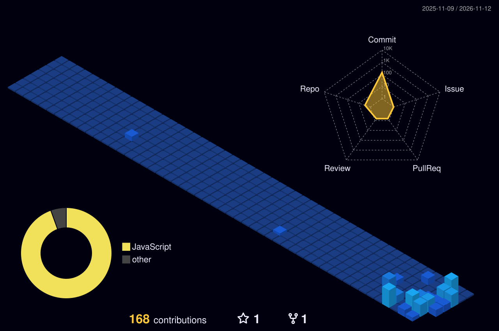

# YAKASUKA

### Independent developer · China

**把重复的事自动化，把想法做成工具。**

[GitHub](https://github.com/yakasuka) · [原创仓库 / Original repositories](https://github.com/yakasuka?tab=repositories&type=source)

---

### PROFILE / 个人简介

关注 Python、自动化与 API 集成，喜欢把日常问题拆解成简单、可靠、可复用的工具。

I build small, practical tools around Python, automation, and APIs—turning repetitive tasks into reusable workflows.

### TOOLKIT / 技术方向

  
  
  
  

### ACTIVITY / 开发节奏

### CONTRIBUTION MAP / 贡献图

Build useful things. Keep it simple.

